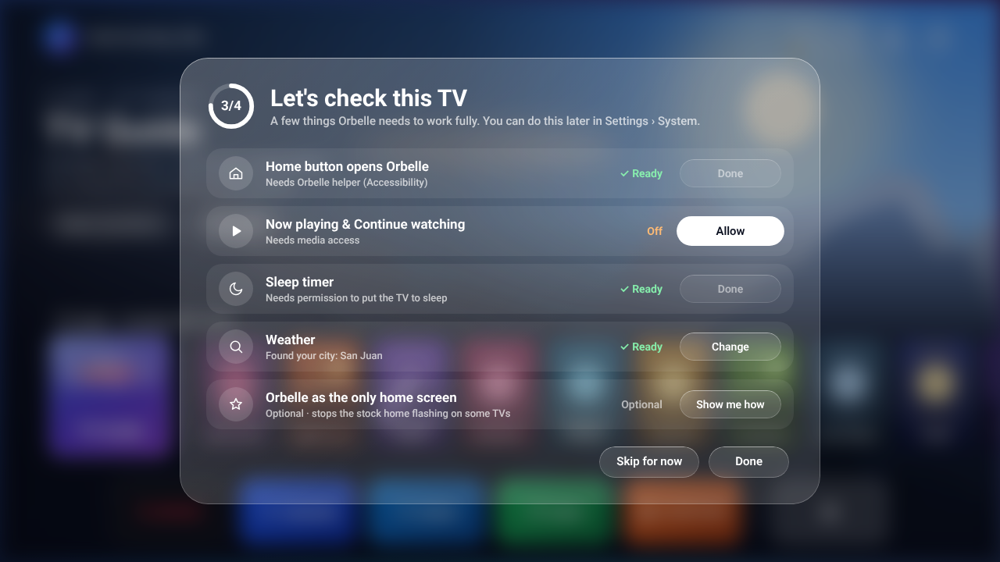
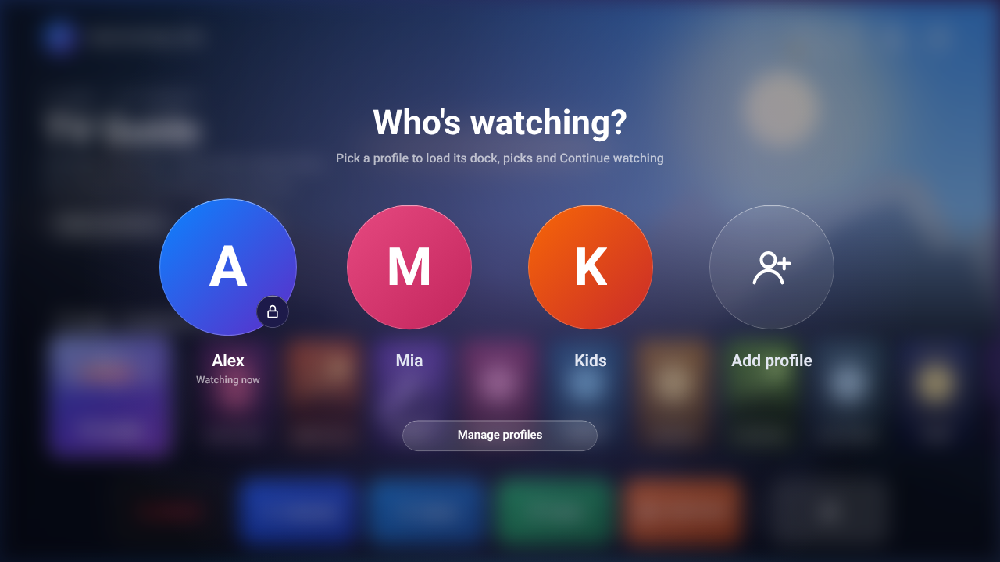
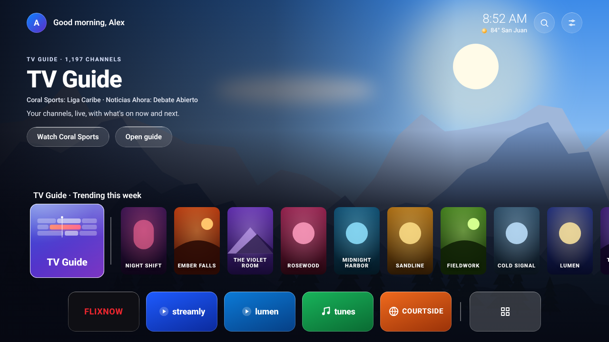
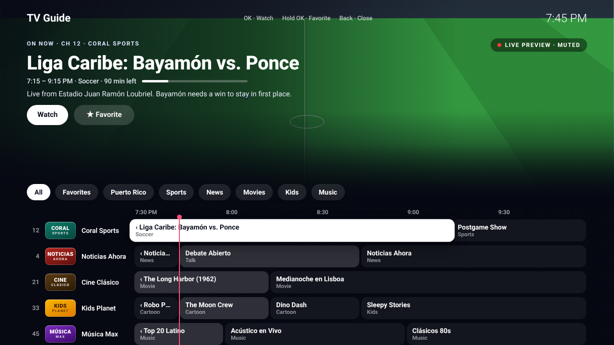
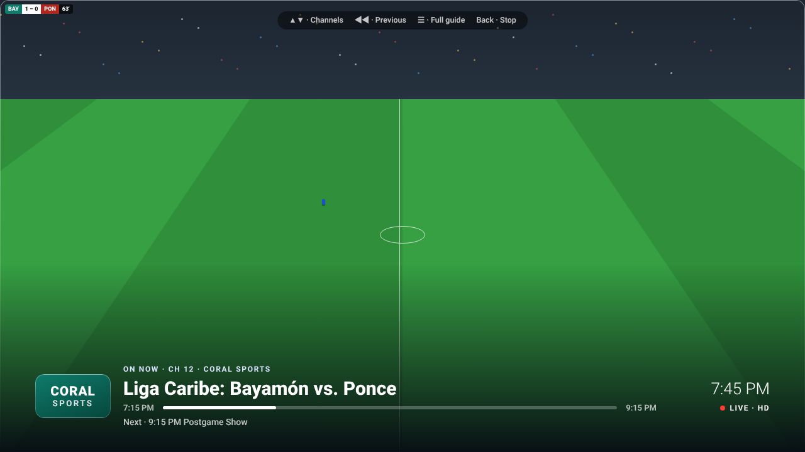
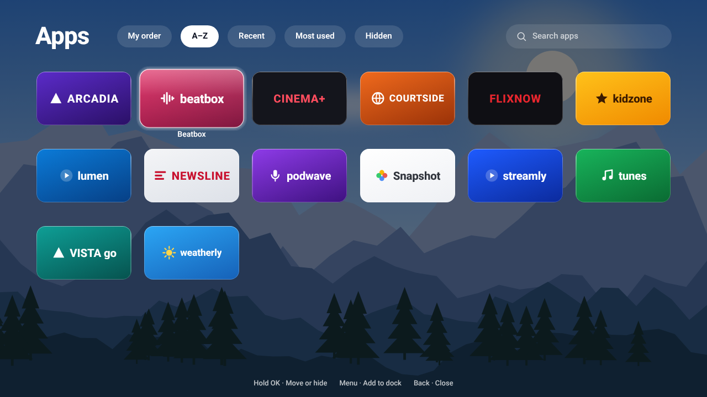
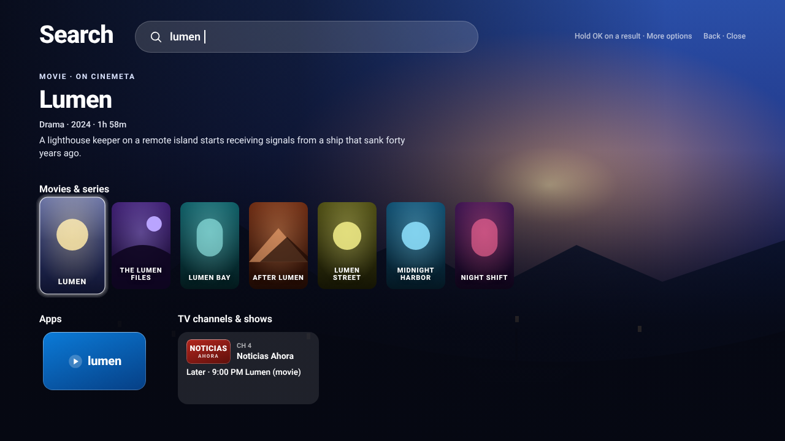
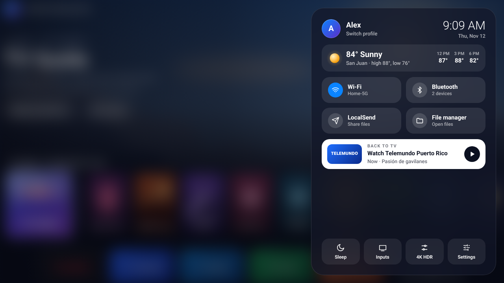
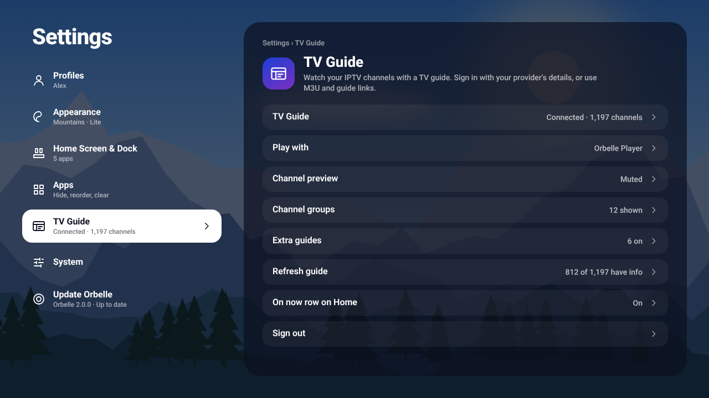
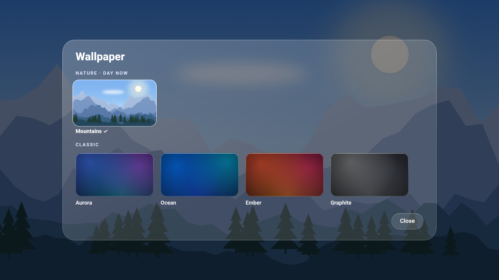

# Orbelle

Your TV, simplified. A fast, modern home screen for Android TV and Google TV.

## Download

Download **[Orbelle-Launcher.apk](https://github.com/xENWewho/orbelle-releases/raw/main/apk/Orbelle-Launcher.apk)** (version 2.0.7). The link downloads the APK directly.
Already have Orbelle? Use **Settings › Update Orbelle** on your TV. Still on 1.0.0? It can't update itself: install the newest version once with Downloader (code **`1415509`**).

## Install with Downloader

On the TV, open the **Downloader** app, enter code **`1415509`** and the APK downloads. The code always gets the newest version.

## Screenshots

| | |
|---|---|
|  **1.** Check this TV: the first screen after installing |  **2.** Who's watching? Pick a profile (each can have a PIN) |
|  **3.** Home: TV Guide pinned in the row over the Mountains wallpaper (a highlighted movie or show fills the screen with its picture) |  **4.** TV Guide: the channel plays across the top, with groups and the schedule below |
|  **5.** Watching a channel in Orbelle Player (press ◀ twice for the previous channel) |  **6.** Apps: sort by A–Z, My order, Recent or Most used, and see hidden apps |
|  **7.** Search: the highlighted result fills the screen, with movies, series, apps, and TV channels and shows from your guide |  **8.** Control Center: weather (OK for 5 days), Wi-Fi, Bluetooth, LocalSend, now playing and Back to TV |
|  **9.** Settings: categories on the left, options on the right |  **10.** Wallpapers: Mountains (day, sunset and night) and the classic ones |

This repository only holds Orbelle's releases: the APK, `latest.json` (what Update Orbelle reads) and release notes. The source code is private.

Copyright © 2026. All rights reserved.

## What's new in 2.0.7

A full-screen More info page, a TV Guide that's harder to close by accident, and a cleaner, flat look everywhere.

- **More info:** movies and series open a full-screen page with the picture, rating, year, length, genres, description, cast and director (seasons and episodes for series), Open and Watch trailer, and More like this.
- **TV Guide Back button:** Back goes to now, then to the group pills, then to All, and then shows "Press Back again to close TV Guide"; if you're watching a channel, it returns you to it.
- **TV Guide look:** the wallpaper shows faintly behind the whole guide, also while a channel is playing.
- **Flat design:** buttons, cards, rows and pills no longer have glass edges or shine, so they read crisply on the TV; the highlighted item still turns white.

## What's new in 2.0.6

Control Center buttons now match the design.

- **Control Center:** Wi-Fi, Bluetooth, LocalSend and File manager are full-height rounded buttons instead of thin pills, and the panel is a more neutral dark.

## What's new in 2.0.5

A cleaner Control Center and smoother Settings.

- **Control Center:** a dark, almost solid panel with flat cards, so nothing behind shows through; only the item you're on turns white, including the weather and Now playing cards.
- **Settings:** moving up and down glides smoothly and keeps room around the highlighted row, so it's never cut off at the top, bottom or right.
- **Featured banner:** stays a simple On or Off setting in Settings › Home.

## What's new in 2.0.4

Returns Home, Control Center and Settings to the 2.0.2 design.

- **Home:** the Home style setting is back to Featured banner, and Home looks as it did in 2.0.2.
- **Control Center:** back to the 2.0.2 glass look; only the item you're on turns white.
- **Settings:** the highlighted row works as it did in 2.0.2.

## What's new in 2.0.3

A Classic home style, a cleaner Control Center, and Settings that are never cut off.

- **Home style:** a new setting in Settings › Home: Full screen, or Classic, Orbelle 1.0's look with the banner in a glass card and the dock in a glass bar.
- **Control Center:** a dark, almost solid panel with flat cards, so nothing behind shows through; only the item you're on turns white, including the weather and Now playing cards.
- **Settings:** the highlighted row is no longer cut off at the right.

## What's new in 2.0.2

Clearer highlights in Control Center and the TV Guide, and easier moving around Settings.

- **Control Center:** only the button you're on turns white; Wi-Fi and Bluetooth show they're on with the blue circle, and the Now playing card shows only while something is playing.
- **TV Guide groups:** only the highlighted group is white; the open group has a small line under its name, and the schedule switches as soon as you stop on a group.
- **Settings:** Left always goes back, and Right or OK changes a value; rows that move something left or right, like Dock position, still use both.
- **Settings text:** descriptions have room for three lines, so they're no longer cut off.
- **Easier to read:** the highlighted item's text is a little bolder, and highlighted rows grow to the right so they stay in line.

## What's new in 2.0.1

A cleaner look that matches the new logo, an easier-to-read TV Guide, and faster channels.

- **TV Guide:** episodes of the same show in a row now appear as one box with the show's full name, and very small boxes no longer show cut-off text.
- **Faster channels:** a channel whose preview is already playing in the TV Guide opens full screen right away, without starting over.
- **Darker glass:** buttons, pills and cards are a bit darker, so they stay easy to read over bright posters and wallpapers.
- **Home:** a light shade at the top keeps the clock and buttons readable, and with the Featured banner off the row now sits just above the dock.
- **Orbelle colors:** the TV Guide card, the Settings icons and the first profile color now use the colors of the new logo.
- **Lite mode:** now off by default; when it's on, Control Center and pop-ups use a deep, almost solid background so nothing shows through.
- **Settings:** moving up and down is smooth, and opening a page or going back no longer makes the highlight jump.

## What's new in 2.0.0

A redesigned Orbelle, with full-screen pictures, a new TV Guide and nature wallpapers that follow the sun.

- **Home:** the highlighted movie or show fills the whole screen behind a bigger title, with TV Guide pinned in the row and your apps below.
- **Apps:** a cleaner grid of six apps across, with the name shown only under the app you're on.
- **Search:** recent searches, trending and channels on now before you type, and results for movies, series, apps, TV channels (by name or number) and shows in your guide.
- **New logo:** a cleaner Orbelle ring with a small planet on its orbit, on the app icon, the TV banner and the No internet screen.
- **Control Center:** a full-height panel with a Back to TV card for your last channel, LocalSend and File manager buttons, a 5-day forecast (OK on the weather), and Restart and Turn off under Hold OK on Sleep.
- **Settings:** categories on the left and their options on the right, with tidier pages for Weather, Recommendations and Permissions, What's new, and an automatic update check.
- **TV Guide:** the highlighted channel plays across the top of the screen, with the show's details over it and a cleaner grid below.
- **Watching TV:** a new starting screen, a new info bar with start and end times, a new channel list, and double-press ◀ to jump back to the previous channel.
- **Mountains wallpaper:** the new default, with day, sunset and night looks that change by themselves with the sun. The classic wallpapers are still there.
- **Lite mode:** lighter pictures and less blur for TV boxes with little memory, on by default on 2 GB boxes (Settings › Appearance).
- **Smoother streams:** guide updates wait while you're watching a channel, so the stream keeps the full connection.
- **Lighter and quicker:** fewer, more useful extra guides, 15 posters in the trending row, the guide's live preview starts once you stop on a channel, and shorter animations on 2 GB boxes.

## What's new in 1.8.0

See which extra guides help your channels, and skip the ones that don't.

- **Extra guides:** each guide now shows how many of your channels it fills, and selecting it names a few of them.
- **Skipped guides:** a guide that fills none of your channels is no longer downloaded, so guide updates are faster; it's checked again once a week, or right away if you switch IPTV service.
- **Your own guide link:** shows how many channels it fills too.
- **Under the hood:** leftover code and old guide files from earlier versions were cleaned up.

## What's new in 1.7.4

Smoother scrolling in the home row.

- **Home row:** moving left or right now scrolls the whole selected poster into view, with room for it to grow, so it's never cut off at the divider or the edge of the screen.

## What's new in 1.7.3

A fix for the pinned TV Guide card on the home screen.

- **Home row:** posters now slide under the divider instead of over the TV Guide card, so TV Guide always stays fully visible.

## What's new in 1.7.2

TV Guide now stays in place on the home screen while the rest of the row scrolls.

- **TV Guide card:** stays fixed at the left with a divider, and On now, Continue watching and Trending scroll beside it.
- **Back:** from anywhere in the row, Back slides the row to the start and puts you on TV Guide.
- **TV Guide artwork:** the card now uses the same artwork as the TV Guide banner, so they match.

## What's new in 1.7.1

A smaller TV Guide card and better matching for Spanish names.

- **TV Guide card:** now a compact square on the home screen, so Continue watching and Trending show up sooner.
- **Guide matching:** accents and ñ no longer matter when matching channels to guides, so "ANDALUCIA TV" now finds "Andalucía TV" and "CINE CLASICO" finds "Cine Clásico". This fills many more Spanish and Latino channels.

## What's new in 1.7.0

TV Guide moves to the home screen.

- **TV Guide card:** TV Guide is now the first card in the home screen's row, followed by your On now channels and a divider before Continue watching.
- **Banner:** highlighting the card shows what's on now on your last channel and favorites, with Watch and Open guide. Before TV Guide is set up, it offers Set up TV Guide.
- **Back in the row:** after scrolling through Continue watching or Trending, Back glides back to the TV Guide card.
- **Dock and app list:** TV Guide no longer appears as an app in the dock, All apps, Search or Settings › Apps. If it was in your dock, that spot goes back to one of your apps.

## What's new in 1.6.4

More guides for Latin American and Spanish channels.

- **Mexico & Latin America:** a new extra guide with about 600 Spanish-language channels (Discovery, ESPN, HBO, TNT, Cinecanal, Azteca, Las Estrellas and more). It turns on for groups named Latino, Latam, Latin or México.
- **Spain (dobleM):** a new extra guide with over 600 channels from Spain, including Movistar+. It turns on for Spain or España groups.
- **Brazil:** removed from Extra guides.
- **Cleaner matching:** when a guide lists the same channel for several countries, Orbelle uses one of them instead of mixing their schedules.

## What's new in 1.6.3

TV Guide information is back.

- **TV Guide:** fixed a problem since 1.6.1 that made every channel show "No guide info". Schedules from your provider and the extra guides show again.

## What's new in 1.6.2

A guide that doesn't go blank, and Puerto Rico channels.

- **TV Guide:** the last saved guide now stays on screen while a new one loads, so channels no longer lose their information during a refresh.
- **Loading:** each guide loads one at a time and shows as soon as it's ready. A guide that fails or takes too long is skipped instead of holding up the rest.
- **Puerto Rico (community):** a new extra guide with Telemundo Puerto Rico, Tele Once, WAPA, WIPR and MegaTV. It turns on automatically when you have a Puerto Rico group.
- **USA local stations:** turned back off if 1.6.1 turned it on, because the file is very large. You can still turn it on in Extra guides.
- **Refresh guide:** now shows which guide is loading and which ones couldn't be loaded.

## What's new in 1.6.1

Cleaner schedules and a better chance at Puerto Rico channels.

- **TV Guide:** a channel listed in more than one guide no longer shows two schedules on top of each other. Each channel now uses one guide, and overlapping shows are removed.
- **Puerto Rico channels:** Orbelle now matches stations by their call letters (WKAQ for Telemundo Puerto Rico, WLII for Tele Once, WAPA, WIPR). With a Puerto Rico group, the USA local stations guide is turned on as well.

## What's new in 1.6.0

Guide info for many more channels.

- **Matching copies:** channels like "Discovery Science (1080p)", "HD" or "US |" versions now use the schedule of the matching channel.
- **Full provider guide:** for Xtream logins, Orbelle also reads your provider's full guide file in the background, which covers more channels than the short guide.
- **Extra guides:** Settings › TV Guide › Extra guides adds free public guides (USA, USA sports, Mexico, Spain and more) to fill channels your provider has no schedule for. The ones that match your channel groups are turned on for you, and you can add your own guide link.
- **Coverage:** Settings › TV Guide › Refresh guide shows how many channels have guide info.
- **Guide:** long channel names end in "…" instead of running into the schedule.

## What's new in 1.5.4

Groups while you watch.

- **Channel list:** press ◀ ▶ to switch groups (All, Favorites and your provider's groups) without leaving the channel you're watching.
- **Starting group:** the list opens on the group you were browsing in the guide. Channels opened from On now open on Favorites.

## What's new in 1.5.3

A fix for opening channels.

- **TV Guide:** fixed a crash ("Orbelle hit a problem") when pressing OK on a channel to watch it in Orbelle Player.

## What's new in 1.5.2

A cleaner channel list, and Orbelle Player for everyone.

- **Channel list:** Up and Down now only browse. Your channel keeps playing until you press OK on another one, and Back closes the list.
- **Layout:** the list sits at the top left with the info bar beside it, so they no longer overlap. Long channel names end in "…".
- **Smoother list:** the list updates in place as you browse, without flicker or doubled text.
- **Orbelle Player:** now the default for every TV Guide channel. You can still pick another app in Settings › TV Guide › Play with.

## What's new in 1.5.1

Orbelle Player: sharper channels, a channel list and no VLC needed.

- **Picture quality:** channels now open in full quality instead of starting blurry.
- **Up/Down while watching:** a channel list opens on the left, and the channel changes when you stop on one. OK shows or hides the list.
- **Opening a channel:** a short loading screen shows the channel's logo while it connects. If a channel doesn't start, Orbelle says so and lets you try again or pick another.
- **Full screen:** the guide's glass highlight no longer shows over the video.
- **VLC removed:** channels play in Orbelle Player. Play with still lets you pick another app already on your TV.

## What's new in 1.5.0

Watch channels right in Orbelle, with the guide on top.

- **Built-in player:** TV Guide channels now play inside Orbelle by default, with nothing extra to install. VLC and other players are still available in Settings › TV Guide › Play with.
- **Full screen:** an info bar shows what's on, the time left and what's next. Up and Down change the channel.
- **Mini guide:** press OK while watching to see the channels around yours, with what's on now and next. Pick one and press OK to switch.
- **Full guide while watching:** press Menu (or Up in the mini guide) and your channel keeps playing in the guide's banner. Back returns to full screen.
- **Fallback:** if a channel doesn't play in Orbelle, it opens in VLC instead, or Orbelle offers to install VLC.

## What's new in 1.4.3

Install VLC right from Orbelle.

- **TV Guide:** when VLC isn't installed, pressing OK on a channel now offers to install it instead of doing nothing. Orbelle downloads VLC from VideoLAN's official site, shows the progress and opens Android's install screen, with no Play Store needed.
- **After installing:** VLC becomes the player for TV Guide and the channel you picked opens in it.
- **Settings › TV Guide:** a new Install VLC row shows while VLC is missing.
- **Errors:** if the download or install fails, Orbelle says why and offers Try again or the Play Store.

## What's new in 1.4.2

Channels play right away.

- **TV Guide:** pressing OK on a channel now opens it straight away in VLC, or in MX Player or another video player when VLC isn't installed, instead of asking each time.
- **Play with:** pick a different player, or choose Ask each time, in Settings › TV Guide › Play with.

## What's new in 1.4.1

A new TV Guide logo.

- **TV Guide tile:** a new full-size logo with a small program grid and the name centered underneath, so the name is no longer cut off as "TV…" on the dock.
- **Settings:** TV Guide's icon now matches the new logo.

## What's new in 1.4.0

TV Guide for your IPTV channels, right in the dock.

- **TV Guide:** sign in with your provider's server, username and password (Xtream), or with M3U and guide (EPG) links, to see your channels and what's on in a grid.
- **Dock:** TV Guide sits in the dock like an app. Move it, remove it or give it a tile picture like any other app.
- **Watching:** press OK to open a channel in VLC, MX Player or your IPTV app. Shows that start later get a reminder instead.
- **Channel preview:** the highlighted channel plays in a small window in the guide's banner, muted, with sound or off.
- **Groups and Favorites:** your provider's groups show across the top. Hold OK to move or hide a group, or to add a channel to Favorites.
- **On now:** your favorite channels and what's on them show first in the home screen's poster row.
- **Backups:** TV Guide settings are saved in backups. The login can be included too, locked with a password.

## What's new in 1.3.0

Sharper app tiles, your own tile pictures, and a smaller download.

- **App tiles:** apps without a TV banner now show their icon big and sharp, with the icon's colors filling the whole tile.
- **Tile picture:** choose your own picture for any app in Settings › Apps › the app › Tile picture. Use the app's own to go back.
- **Control Center:** File manager replaces Clean RAM, which barely did anything on current Android.
- **Orbelle's logo:** it now shows correctly in the TV's own app lists instead of Android's default icon.
- **Hold OK on an app:** the highlight around the pressed tile now uses the same glass look as the rest of Orbelle.
- **Smaller download:** the APK is about half the size (about 400 KB).

## What's new in 1.2.3

A cleaner way back from All apps.

- **Back from All apps and Search:** the glass highlight now disappears the moment you press Back, so no glow is left behind while the screen closes.

## What's new in 1.2.2

Cleaner closing and a quicker hold menu.

- **Back from All apps, Search, Control Center and Who's watching:** the glass highlight no longer flashes on a tile in the middle of the screen before landing on the dock.
- **Hold OK on an app:** the menu opens faster. The background blurs once instead of animating the blur.

## What's new in 1.2.1

A smoother glass highlight.

- **All apps and Search:** when you close them, the glass highlight now fades out with the screen instead of staying in the middle.
- **Hold OK on an app:** the menu opens faster. The glass steps aside while a menu is open and only redraws when it moves.

## What's new in 1.2.0

A smoother way to move around.

- **Highlight:** one glass highlight now glides from tile to tile, with a soft little bounce, on the dock, posters, All apps and Search. The tile you're on still grows.
- **Performance:** the highlight is drawn once and slid into place, so moving around is lighter on TV boxes.
- **Credits:** Settings › System › About Orbelle lists open-source licenses. The glass highlight is based on CleanYourTV by Gathin (MIT License).

## What's new in 1.1.5

Clearer icons throughout Settings.

- **Icons:** every item in Settings, Control Center and Check this TV now has an icon that matches its name. Items with "Settings" use a gear, items with "Home" use a house, and no icon is reused for something different.
- **Apps:** in Settings › Apps, the highlighted app now shows its own logo.
- **Permanent setup:** long titles now fit, and the steps show their names, with the command shown under the description.

## What's new in 1.1.4

A clearer Settings icon and smoother Check this TV.

- **Control Center:** the Settings button now has a gear icon, so it no longer looks like a sun.
- **Check this TV:** closing it from Settings › System now returns to the same row, without the page reloading or the highlight jumping to Default home screen.

## What's new in 1.1.3

A tidier Settings page.

- **Settings:** the System row no longer repeats Orbelle's version, which is already shown on Update Orbelle right below it.

## What's new in 1.1.2

The banner buttons now work for what you're watching.

- **Continue watching:** "Watch trailer" and "More info" now work when the banner shows something you're in the middle of. More info shows where you left off, with Resume, Watch trailer and Close.

## What's new in 1.1.1

Smoother updates.

- **Updates:** after updating from Settings › Update Orbelle, Orbelle now opens again right away, so the TV's stock home screen only flashes briefly.

## What's new in 1.1.0

A fresher home screen every day.

- **Trending:** the row now mixes popular titles with new releases from this year, so you see recent movies and series, not only the biggest hits.
- **Daily refresh:** the order of the row changes every day.

## What's new in 1.0.3

Search is simpler and more reliable.

- **Search:** removed the voice search (mic) button, which didn't work reliably on every TV. Search by typing a movie, series or app name.

## What's new in 1.0.2

Stability improvements and a clearer update message.

- **Updates:** "Orbelle is up to date" now shows in green instead of orange, so it no longer looks like an error.
- **Stability:** removed the last piece of code that could crash Orbelle on some TVs, and added a check so it can't come back.

## What's new in 1.0.1

A fix for a crash when opening Settings.

- **Settings:** fixed a crash when opening Settings on some TVs, caused by the automatic update check.
- **Updates:** if you have 1.0.0, install 1.0.1 once with Downloader (code 1415509). Future updates then work from Settings › Update Orbelle.

## What's new in 1.0.0

Orbelle's first public release.

- **Home screen:** a glass-style home with a customizable dock (up to 5 apps plus All apps), Continue watching and trending titles.
- **Control Center:** current weather and hourly forecast, Wi-Fi status with a built-in speed test, and what's playing now.
- **Profiles:** separate profiles for each person, each with its own name, photo and optional PIN lock.
- **Search:** find apps, movies and shows by typing or by voice.
- **Updates:** install new versions of Orbelle directly from Settings › Update Orbelle.
