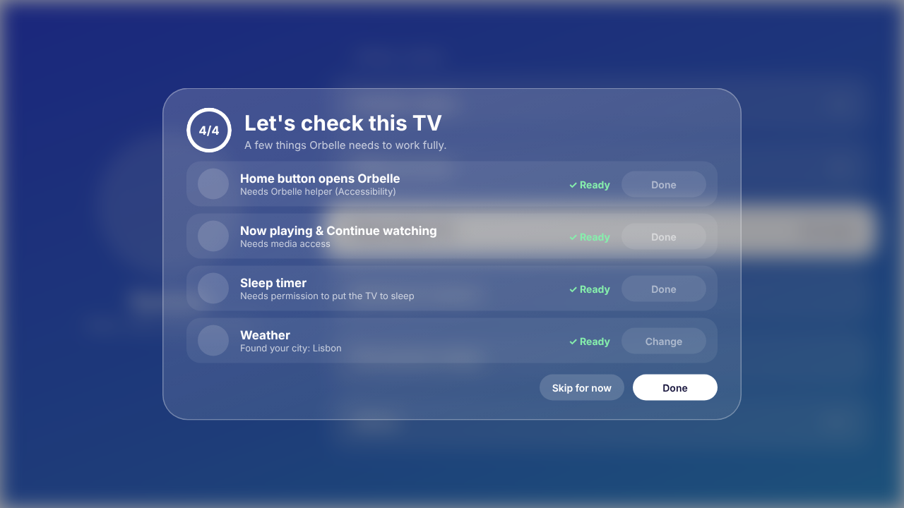
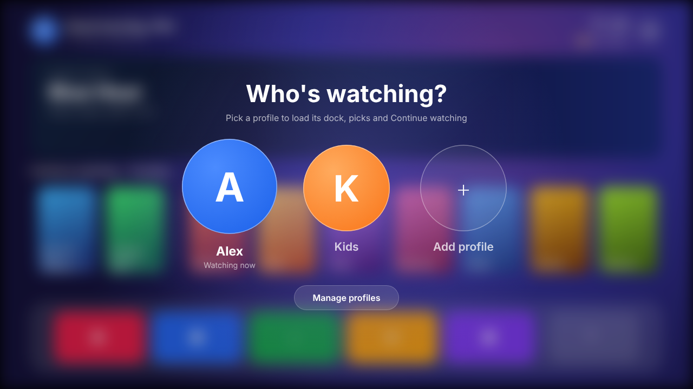
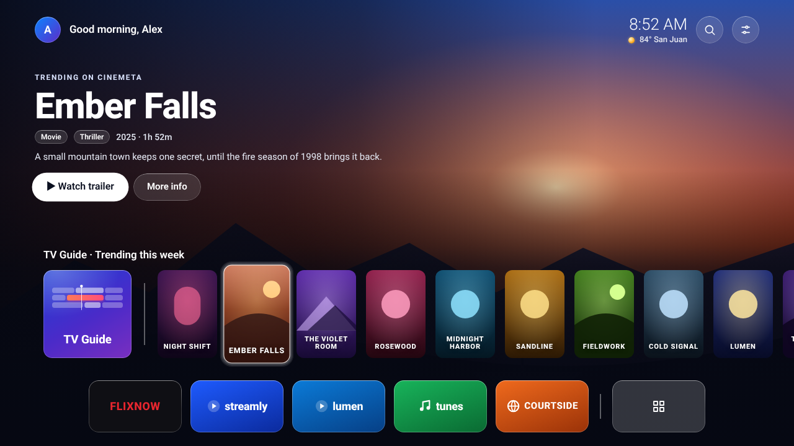
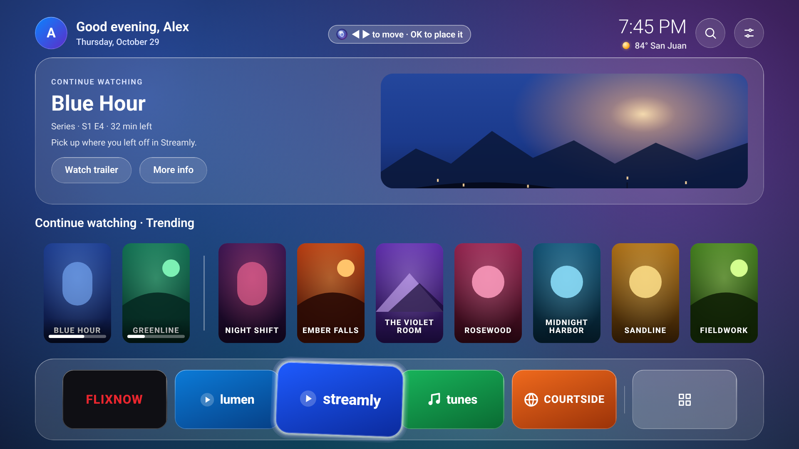
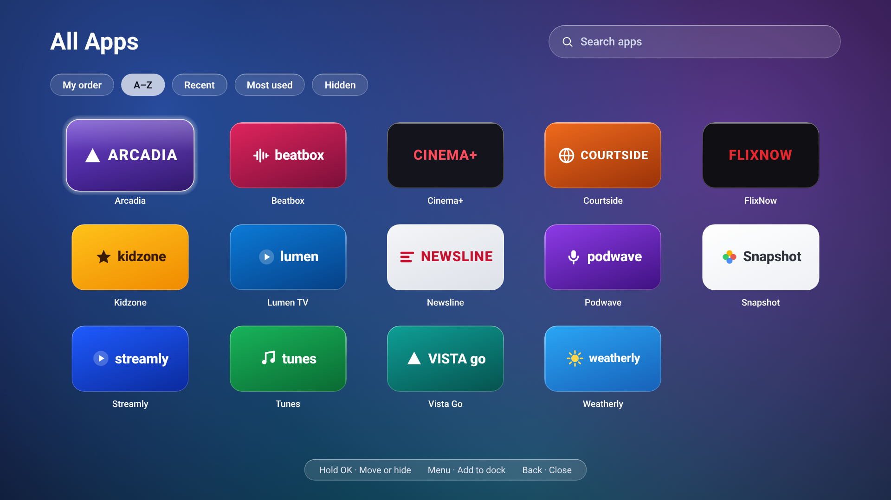
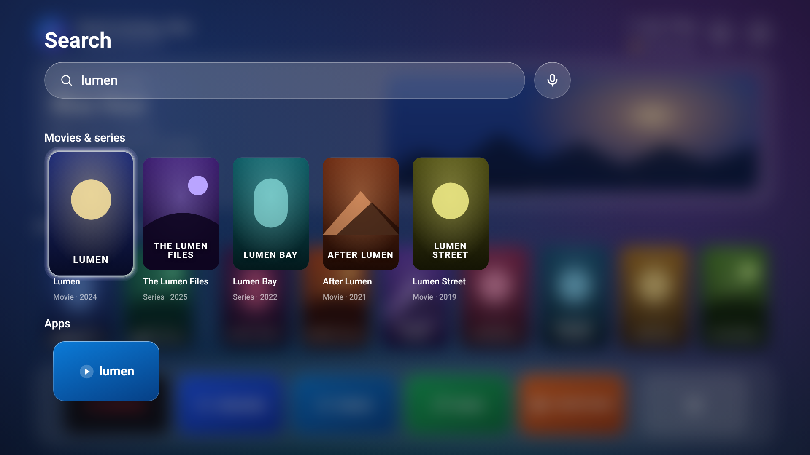
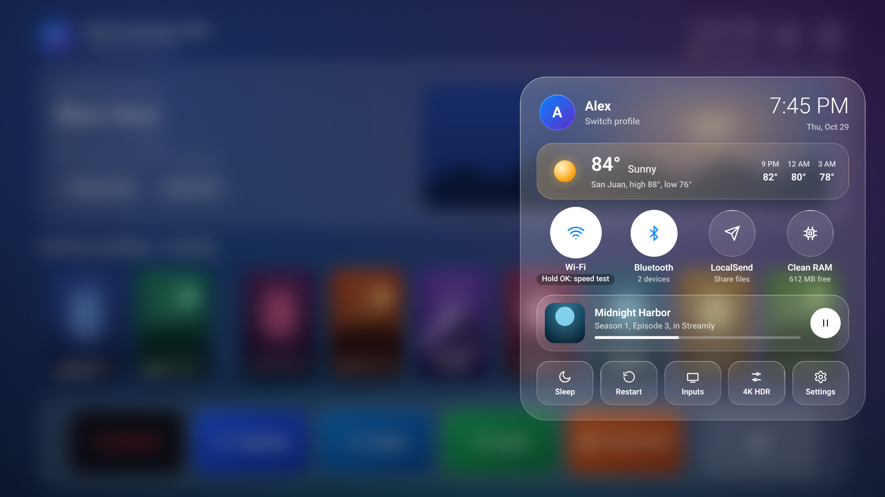
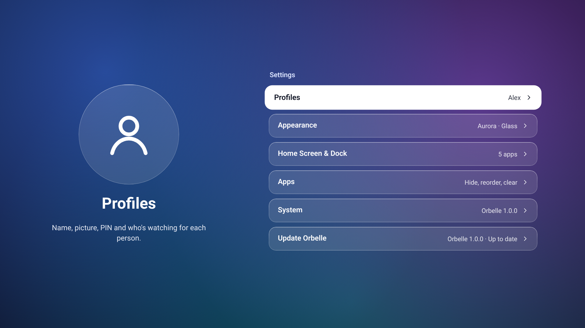

# Orbelle

A glassy, Apple TV–style launcher for Android TV and Google TV boxes.

## Download

Download **[Orbelle-Launcher.apk](https://github.com/xENWewho/orbelle-releases/raw/main/apk/Orbelle-Launcher.apk)** (version 1.2.1). The link downloads the APK directly.
Already have Orbelle? Use **Settings › Update Orbelle** on your TV.

## Install with Downloader

On the TV, open the **Downloader** app, enter code **`1415509`** and the APK downloads. The code always gets the newest version.

## Screenshots

| | |
|---|---|
|  **1.** Check this TV: the first screen after installing |  **2.** Who's watching? Pick a profile (each can have a PIN) |
|  **3.** Home: banner, Continue watching and trending |  **4.** Rearranging the dock |
|  **5.** All apps: sort by My order, A–Z, Recent or Most used, and see hidden apps |  **6.** Search: movies, series and apps |
|  **7.** Control Center: weather, Wi-Fi speed test, now playing |  **8.** Settings |

This repository only holds Orbelle's releases: the APK, `latest.json` (what Update Orbelle reads) and release notes. The source code is private.

Copyright © 2026. All rights reserved.

## What's new in 1.2.1

A smoother glass highlight.

- **All apps and Search:** when you close them, the glass highlight now fades out with the screen instead of staying in the middle.
- **Hold OK on an app:** the menu opens faster. The glass steps aside while a menu is open and only redraws when it moves.

## What's new in 1.2.0

A smoother way to move around.

- **Highlight:** one glass highlight now glides from tile to tile, with a soft little bounce, on the dock, posters, All apps and Search. The tile you're on still grows.
- **Performance:** the highlight is drawn once and slid into place, so moving around is lighter on TV boxes.
- **Credits:** Settings › System › About Orbelle lists open-source licenses. The glass highlight is based on CleanYourTV by Gathin (MIT License).

## What's new in 1.1.5

Clearer icons throughout Settings.

- **Icons:** every item in Settings, Control Center and Check this TV now has an icon that matches its name. Items with "Settings" use a gear, items with "Home" use a house, and no icon is reused for something different.
- **Apps:** in Settings › Apps, the highlighted app now shows its own logo.
- **Permanent setup:** long titles now fit, and the steps show their names, with the command shown under the description.

## What's new in 1.1.4

A clearer Settings icon and smoother Check this TV.

- **Control Center:** the Settings button now has a gear icon, so it no longer looks like a sun.
- **Check this TV:** closing it from Settings › System now returns to the same row, without the page reloading or the highlight jumping to Default home screen.

## What's new in 1.1.3

A tidier Settings page.

- **Settings:** the System row no longer repeats Orbelle's version, which is already shown on Update Orbelle right below it.

## What's new in 1.1.2

The banner buttons now work for what you're watching.

- **Continue watching:** "Watch trailer" and "More info" now work when the banner shows something you're in the middle of. More info shows where you left off, with Resume, Watch trailer and Close.

## What's new in 1.1.1

Smoother updates.

- **Updates:** after updating from Settings › Update Orbelle, Orbelle now opens again right away, so the TV's stock home screen only flashes briefly.

## What's new in 1.1.0

A fresher home screen every day.

- **Trending:** the row now mixes popular titles with new releases from this year, so you see recent movies and series, not only the biggest hits.
- **Daily refresh:** the order of the row changes every day.

## What's new in 1.0.3

Search is simpler and more reliable.

- **Search:** removed the voice search (mic) button, which didn't work reliably on every TV. Search by typing a movie, series or app name.

## What's new in 1.0.2

Stability improvements and a clearer update message.

- **Updates:** "Orbelle is up to date" now shows in green instead of orange, so it no longer looks like an error.
- **Stability:** removed the last piece of code that could crash Orbelle on some TVs, and added a check so it can't come back.

## What's new in 1.0.1

A fix for a crash when opening Settings.

- **Settings:** fixed a crash when opening Settings on some TVs, caused by the automatic update check.
- **Updates:** if you have 1.0.0, install 1.0.1 once with Downloader (code 1415509). Future updates then work from Settings › Update Orbelle.

## What's new in 1.0.0

Orbelle's first public release.

- **Home screen:** a glass-style home with a customizable dock (up to 5 apps plus All apps), Continue watching and trending titles.
- **Control Center:** current weather and hourly forecast, Wi-Fi status with a built-in speed test, and what's playing now.
- **Profiles:** separate profiles for each person, each with its own name, photo and optional PIN lock.
- **Search:** find apps, movies and shows by typing or by voice.
- **Updates:** install new versions of Orbelle directly from Settings › Update Orbelle.
